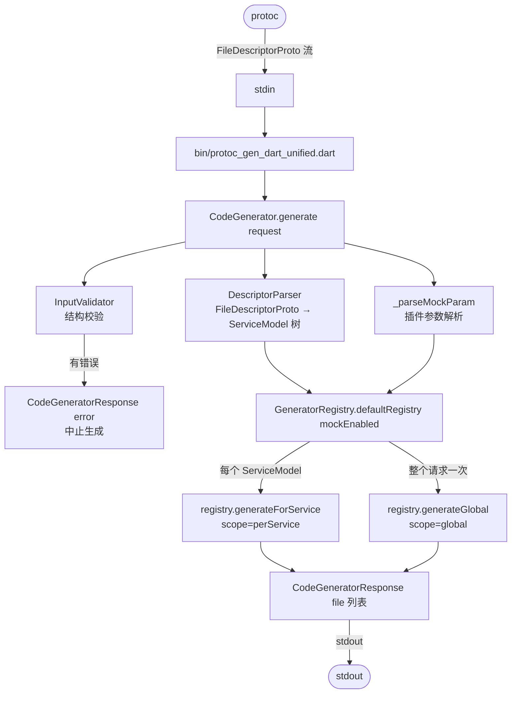
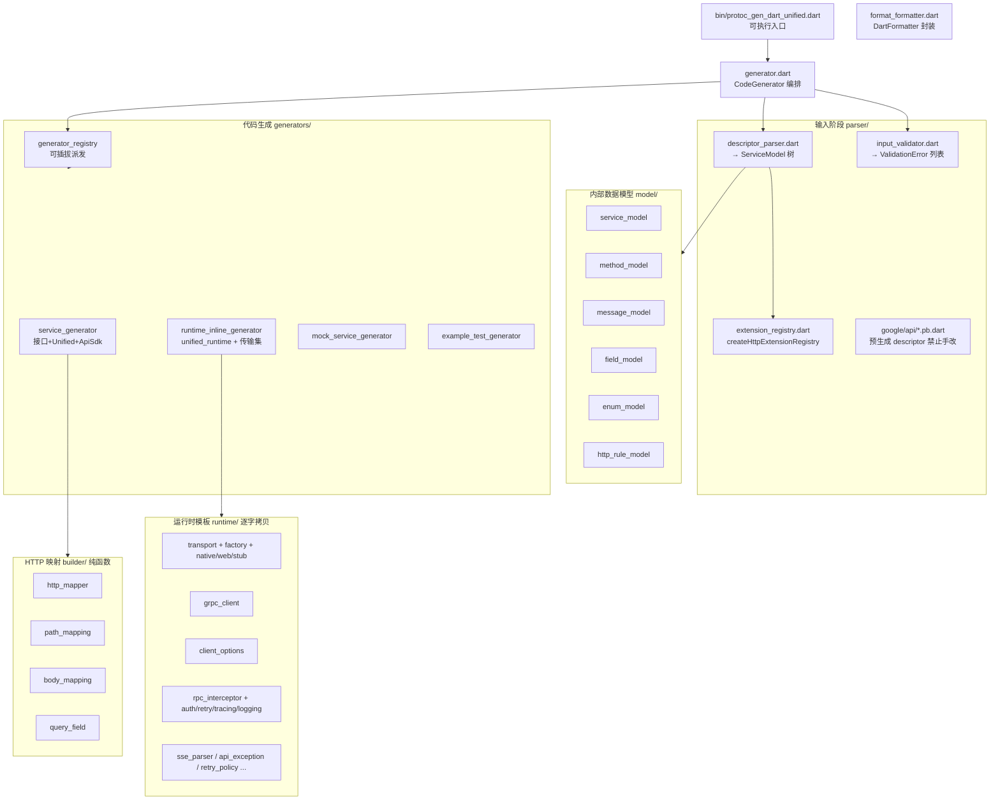
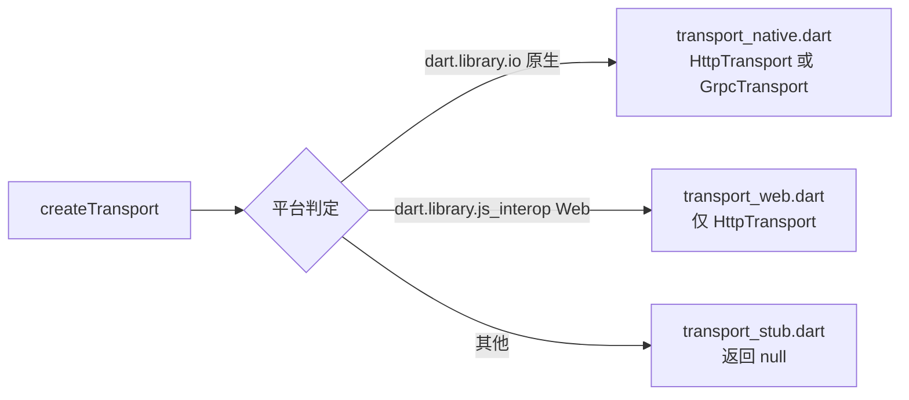
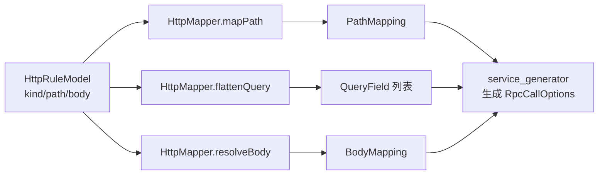
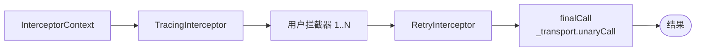

# protoc-gen-dart-unified — 架构文档

> 本文件是 `protoc-gen-dart-unified`（面向 `protoc` 的统一 RPC SDK 代码生成器插件）的**技术架构参考**，
> 描述插件*是如何构建的*（模块职责、数据流、代码生成流水线）。
> 设计决策与背景请参见 [`design.md`](./design.md)；终端用户使用方式请参见 [`usage.md`](./usage.md)。

---

## 1. 总览

`protoc-gen-dart-unified` 是一个 Dart 可执行程序：从 **stdin** 读取 `CodeGeneratorRequest`，
向 **stdout** 写出 `CodeGeneratorResponse`。它把单个带 `google.api.http` 注解的 `.proto` 定义，
生成出一套完整的 Flutter RPC 客户端 SDK，在**统一接口**之下同时支持 **HTTP/REST** 与 **gRPC** 两种传输，
并通过**编译期条件导入**（而非运行时 `kIsWeb`）进行选择。

插件本身不会被发布给使用者——它只在构建期运行。其产物是一组 `.dart` 文件，使用者像引入普通包代码一样引入即可。

### 1.1 关键特征

| 属性 | 值 |
|---|---|
| 语言 | Dart（插件本体 + 生成产物） |
| 入口 | `bin/protoc_gen_dart_unified.dart` → `CodeGenerator.generate` |
| 解析基础 | 官方 `protoc_plugin` 的 descriptor protobuf |
| 代码生成栈 | `code_builder`（AST）→ `DartEmitter` → `dart_style` 格式化 |
| 运行时依赖 | 仅 `dio`（生成产物中） |
| 传输选择 | 编译期条件导入（`dart.library.io` / `dart.library.js_interop`） |
| 命名转换 | Proto `PascalCase` → 文件 `snake_case`，方法 `camelCase` |

### 1.2 边界为何如此划分

- **自包含运行时**：所有运行时类型以内联方式写入 `unified_runtime.dart`（外加一组条件导入的传输文件），
  因此*使用者*除 `dio` 外对插件零依赖。插件内的 `lib/src/runtime/` 源码是被逐字拷贝到产物中的"真值模板"。
- **编译期传输切分**：任何文件中只要 `import 'package:grpc/grpc.dart'`，无论运行时分支如何，gRPC 都会被
  打进 Web 产物，使 tree-shaking 失效。条件导入工厂（`unified_transport_factory.dart`）把 `grpc`/`dart:io`
  代码完全排除在 Web 构建之外（见 §5）。
- **可插拔生成**：派发由注册表驱动，而非硬编码在 `CodeGenerator` 中，新增输出文件类型只需在一个地方登记。

---

## 2. 高层流水线



插件是**快速失败**的：任一 `ValidationError` 都会以 `CodeGeneratorResponse(error: ...)` 短路整个请求。
结构校验仅在 `fileToGenerate` 非空时运行（空列表是 protoc 的*能力探测*，不应报错）。

---

## 3. 模块地图



各模块清单：

```
bin/
└── protoc_gen_dart_unified.dart        # 可执行入口：stdin → request → response → stdout

lib/src/
├── generator.dart                      # CodeGenerator：编排 validate → parse → dispatch
├── format_formatter.dart               # DartFormatter 封装（钉死 languageVersion）
├── parser/                             # ── 输入阶段（proto → 内部模型）
│   ├── descriptor_parser.dart         #   FileDescriptorProto → List<ServiceModel>
│   ├── extension_registry.dart        #   createHttpExtensionRegistry()（google.api.http）
│   ├── input_validator.dart           #   结构校验 → List<ValidationError>
│   └── google/api/                     #   预生成 pb descriptor（禁止手改）
├── model/                             # ── 内部数据模型（值对象）
│   ├── service_model.dart             #   ServiceModel
│   ├── method_model.dart              #   MethodModel（入参/出参类型、httpRule、流式）
│   ├── message_model.dart             #   MessageModel（字段、嵌套枚举）
│   ├── field_model.dart               #   FieldModel（类型、repeated、map、oneof、enum）
│   ├── enum_model.dart                #   EnumModel / EnumValueModel
│   └── http_rule_model.dart           #   HttpRuleModel（+ additionalBindings）
├── builder/                           # ── HTTP 映射（纯函数）
│   ├── http_mapper.dart               #   mapPath / flattenQuery / resolveBody / toCamelCase
│   ├── path_mapping.dart              #   PathMapping 结果
│   ├── body_mapping.dart              #   BodyMapping 结果（all|field|none）
│   └── query_field.dart               #   QueryField 结果
├── generators/                        # ── 代码生成阶段（模型 → Dart 源码）
│   ├── generator_registry.dart        #   可插拔派发；defaultRegistry() 登记 9 个 entry(mock 开启)/7 个(mock 关闭)
│   ├── service_generator.dart         #   接口 + Unified 实现 + ApiSdk
│   ├── runtime_inline_generator.dart   #   产出 unified_runtime.dart + 传输文件集(含 adapter)
│   ├── mock_service_generator.dart    #   基于 mockito 的 Mock 类
│   └── example_test_generator.dart    #   带 stub 的测试脚手架
└── runtime/                           # ── 运行时模板（逐字拷贝到产物）
    ├── transport.dart                 #   抽象 Transport + executeWithInterceptors
    ├── transport_factory.dart         #   条件导入 createTransport()
    ├── transport_native.dart          #   dio HTTP + GrpcTransport（dart:io）
    ├── transport_web.dart             #   dio HTTP 仅此（js_interop）
    ├── transport_stub.dart            #   兜底（返回 null）
    ├── grpc_client.dart               #   抽象 GrpcClient 接口
    ├── client_options.dart            #   ClientOptions + buildInterceptorChain()
    ├── rpc_interceptor.dart           #   RpcInterceptor 基类
    ├── {auth,retry,tracing,logging}_interceptor.dart
    ├── rpc_call_options.dart          #   RpcCallOptions（httpMethod/path/query）
    ├── rpc_cancel_token.dart          #   单次调用取消
    ├── retry_policy.dart / with_retry.dart
    ├── sse_parser.dart                #   Server-Sent Events 解析
    ├── api_exception.dart / http_status_mapping.dart
    └── protocol.dart                  #   Protocol 枚举（auto|http|grpc）
```

---

## 4. 输入阶段 — 解析与校验

### 4.1 `InputValidator`（`parser/input_validator.dart`）

纯结构校验。**绝不修改** descriptor。返回 `List<ValidationError>`（严重度 `error` | `warning`）；
空列表即表示通过。

校验项：
- 至少提供了一个 proto 文件。
- 每个文件都定义了 ≥ 1 个 service。
- 每个 service 名称非空且定义了 ≥ 1 个方法。
- 同一 service 内方法名无重复。

任一错误 → `CodeGeneratorResponse(error: 拼接信息)`，中止生成。

### 4.2 `DescriptorParser`（`parser/descriptor_parser.dart`）

`parse(List<FileDescriptorProto>)` → `List<ServiceModel>`。职责：

- **消息树**：为每个 `DescriptorProto` 构建 `MessageModel`，含嵌套枚举、`oneof` 解析、
  **map 检测**（字段为 `TYPE_MESSAGE` 且其 entry 消息 `options.mapEntry == true`）、枚举字段取值提取。
- **方法提取**：把每个 `MethodDescriptorProto` 映射为 `MethodModel`（入参/出参取最后一段点名、流式标志）。
- **HttpRule 提取**：`_extractHttpRule` 用 `extension_registry.dart` 的 `ExtensionRegistry` 从原始
  字节重新解析 `MethodOptions`。标准 descriptor 解析不会填充自定义选项，因此必须这样做；
  `hasOptions()` 为 false → `httpRule: null`。
- **HttpRule 映射**：`_mapHttpRule` 把 protobuf `HttpRule`（get/put/post/delete/patch/custom +
  body + responseBody + additionalBindings）转换为 `HttpRuleModel`。

`createHttpExtensionRegistry()` 是 `google.api.http` 扩展的唯一来源，仅在此处消费。

### 4.3 `google/api/*.pb.dart`

`google.api.http` / `Annotations` 自定义选项的预生成 protobuf descriptor 类。**禁止手改**——从 protoc 重新生成。

---

## 5. 传输层与编译期切分（核心设计）

这是系统架构意义最重大的部分，解决一个问题：**把 `grpc`/`dart:io` 排除在 Web 包之外**，同时在原生端仍支持 gRPC。

### 5.1 条件导入工厂

`runtime/transport_factory.dart`（产物中为 `unified_transport_factory.dart`）：

```dart
import 'transport.dart';
import 'grpc_client.dart';
import 'transport_stub.dart'
    if (dart.library.io) 'transport_native.dart'
    if (dart.library.js_interop) 'transport_web.dart'
    as impl;

Transport? createTransport(String endpoint, {GrpcClient? grpcClient, ...}) =>
    impl.createTransport(endpoint, grpcClient: grpcClient, ...);
```



- **原生**（`dart.library.io`）：`impl` 解析为 `transport_native.dart` → `HttpTransport`（dio）
  **或** `GrpcTransport`（当提供了 `GrpcClient` 时）。
- **Web**（`dart.library.js_interop`）：`impl` 解析为 `transport_web.dart` → 仅 `HttpTransport`
  （Web 上不可能用 gRPC）。
- **其他平台**：`transport_stub.dart` 返回 `null`（让导入图在不支持平台上仍合法）。

由于 `transport_native.dart`（引入 `dart:io` 与 gRPC）仅被*条件*导入，它永远不会编译进 Web 构建→ tree-shaking 生效。

### 5.2 传输抽象

`Transport`（`transport.dart`）定义了生成代码使用的契约：

```dart
abstract class Transport {
  Future<T> unaryCall<T>(String serviceName, String methodName, Object request,
      {RpcCallOptions? options});
  Stream<T> serverStream<T>(String serviceName, String methodName, Object request,
      {RpcCallOptions? options});
  Future<T> executeWithInterceptors<T>(
    String serviceName,
    String methodName,
    Object request,
    RpcCallOptions? options,
    List<RpcInterceptor> interceptors,
    Future<T> Function(Object req, RpcCallOptions? opts) finalCall,
  );
}
```

- 实现类：`HttpTransport`（原生 + Web，基于 dio）与 `GrpcTransport`（仅原生，包裹 `GrpcClient`）。
- `serverStream` 在 HTTP 上走 **SSE**；gRPC 委托给生成的 `*ServiceClient`。
- 客户端/双向流式在 HTTP 上不支持（抛 `UnsupportedError`）。

### 5.3 gRPC 接线

`GrpcClient`（`grpc_client.dart`）是一个**抽象**接口，屏蔽了生成的 `*.pbgrpc.dart` 的 `*ServiceClient`。
生成的 `ApiSdk`（§7.3）把一个可选的 `grpcClient`（`GrpcClient`）透传给 `createTransport`——它从不被
直接持有，因此 service 文件保持无 `dart:io`/`grpc` 导入、可在 Web 编译。

- **平台传输** `unified_transport_native.dart`（`TransportNative`，global）：条件导出 `transport_native.dart`，
  内含 `GrpcTransport`（包裹 `GrpcClient`）。它是**平台级**代码，不按 service 拆分。
- **按 service 的 gRPC 适配器** `unified_transport_adapter_{name}.dart`（`TransportAdapter`，perService）：
  由 `RuntimeInlineGenerator.generateTransportAdapter(service)` 生成，**按 service 一份**，用于引入使用者
  的 `*.pbgrpc.dart` 并实现 `GrpcClient`（`{Service}GrpcAdapter`），把具名方法分派到生成客户端。
  这一拆分把 `grpc`/`dart:io` 依赖隔离在原生专用文件里，service SDK 主文件保持 Web 安全。

### 5.4 `Protocol.auto` 解析

| 运行环境 | `protocol` 配置 | 实际传输 |
|---|---|---|
| Web | 任意 | **http**（强制） |
| 原生 | 有 `grpcClient` | **grpc**（优先） |
| 原生 | 仅 http | http |

在编译期（平台）+ 构造期（配置）决定；运行时不做协议探测。

---

## 6. HTTP 映射引擎（`builder/`）

无状态纯函数，把 `HttpRuleModel` 转换为代码生成输入。无 I/O、无运行时依赖——平台无关。仅被
`service_generator.dart` 消费。

| 函数 | 用途 |
|---|---|
| `HttpMapper.mapPath` | `{field}` / `{field=segs/*}` 路径模板的状态机解析器 → `PathMapping`（字面量段 + 字段名）。**非正则**（嵌套大括号下正确）。 |
| `HttpMapper.flattenQuery` | 不在路径中、也不是 body 的字段 → `List<QueryField>`。 |
| `HttpMapper.resolveBody` | body `"*"` → `all`，字段名 → `field`，空 → `none` → `BodyMapping`。 |
| `HttpMapper.toCamelCase` | `page_size` → `pageSize`（proto 字段 → Dart 访问器）。 |

结果值对象（`PathMapping`、`BodyMapping`、`QueryField`）均不可变。



---

## 7. 代码生成阶段

### 7.1 `GeneratorRegistry`（`generators/generator_registry.dart`）

可插拔派发，替代 `CodeGenerator` 中的硬编码逻辑。每个 `GeneratorEntry` 拥有：
- `scope`：`perService`（每 service 一份产物）或 `global`（每请求一次）。
- `serviceGenerator` / `globalGenerator` 工厂闭包。
- `fileNameFn` → 输出文件名。
- `enabled` 标志（运行时开关，如 `mock` 参数）。

`defaultRegistry({mockEnabled})` 登记 **9 个 entry**（含 `Mock`/`ExampleTest` 时；关闭 `mock` 后为 7 个）：

| Entry | Scope | 文件 | 内容 |
|---|---|---|---|
| `Service` | perService | `{name}.dart` | 接口 + `Unified{Service}` + `ApiSdk` |
| `Mock` | perService | `{name}_mock.dart` | 基于 mockito 的 Mock（仅 `mockEnabled`） |
| `ExampleTest` | perService | `{name}_example_test.dart` | 测试脚手架（仅 `mockEnabled`） |
| `RuntimeInline` | global | `unified_runtime.dart` | 自包含运行时类型 |
| `TransportFactory` | global | `unified_transport_factory.dart` | 条件导入 `createTransport` |
| `TransportNative` | global | `unified_transport_native.dart` | 原生 HTTP 传输 + `GrpcTransport` 封装（平台代码，非按 service） |
| `TransportWeb` | global | `unified_transport_web.dart` | Web HTTP 传输 |
| `TransportStub` | global | `unified_transport_stub.dart` | 兜底 null 传输 |
| `TransportAdapter` | perService | `unified_transport_adapter_{name}.dart` | 按 service 的 gRPC 适配器，实现 `GrpcClient`（仅原生，包裹 `*.pbgrpc.dart`） |

`generateForService` 遍历 `perService` entry（`Service`/`Mock`/`ExampleTest`/`TransportAdapter`）；
`generateGlobal` 每请求产出一次（插入到响应文件列表头部）。

### 7.2 `ServiceGenerator`（`generators/service_generator.dart`）

通过 `code_builder` 构建每 service 文件：

1. **抽象接口** `{ServiceName}` —— 每个 proto RPC 一个抽象方法
   （`Future<Out> method(In req)`，server-streaming 则为 `Stream<Out>`）。
2. **`Unified{ServiceName}`** —— `implements` 该接口；持有 `_transport` 与 `_interceptors`。每个方法体：
   - HTTP 上的客户端流式 → 抛 `UnsupportedError`。
   - server-streaming：`_transport.serverStream`（HTTP 走 SSE，否则走 gRPC）。
   - unary：构建 `InterceptorContext`，把核心调用包进拦截器链（在*生成的方法内*构建，**而非** `Transport` 内），
     再调用 `chain(context)`。
   - 传输选择按 service：`_useHttp = methods.any(httpRule != null)`。HTTP 方法生成 `RpcCallOptions`
     （method/path/query，经 `HttpMapper`）；gRPC 方法传 `options: null`，调用同样流经 `_transport.unaryCall`
     ——**两条分支共享同一传输派发**。
3. **`ApiSdk`** —— 入口类。读取 `ClientOptions`，计算有效拦截器链
   （`options.buildInterceptorChain() + extraInterceptors`），调用 `createTransport(options.endpoint, ...)`，
   构造 `Unified{ServiceName}(transport, _chain)`。对于 gRPC service，它还接受一个具名 `grpcClient`
   参数，透传给 `createTransport`。

生成文件始终以 `// ignore_for_file: type=lint` 开头，并用
`DartFormatter(languageVersion: Version(3, 10, 0))` + `DartEmitter.scoped(useNullSafetySyntax: true)` 格式化。

### 7.3 `RuntimeInlineGenerator`（`generators/runtime_inline_generator.dart`）

基于模板的发射器（最大文件）。`generate()` 返回完整的 `unified_runtime.dart` 源码——从 `lib/src/runtime/`
逐字拷贝运行时类型（异常、`ApiException` 体系、拦截器、options、取消令牌、SSE 解析器、重试工具、`Protocol` 枚举），
唯一外部依赖为 **`package:dio/dio.dart`**。它另提供 `generateTransportFactory`、`generateTransportWeb`、
`generateTransportStub`、`generateTransportNative()`，发射其余运行时文件。
`unified_runtime.dart` 再导出 `unified_transport_factory.dart`，使使用者透明解析 `createTransport`。
`RuntimeInlineGenerator` 另提供 `generateTransportFactory`、`generateTransportWeb`、`generateTransportStub`、
`generateTransportNative()`（global，无 service 参数）、`generateTransportAdapter(service)`（perService gRPC 适配器）。

### 7.4 `MockServiceGenerator` / `ExampleTestGenerator`

- `MockServiceGenerator`：基于 mockito、实现 service 接口的类，供测试用。
- `ExampleTestGenerator`：按方法生成 `group`/`test` 脚手架，带 mockito `when` stub。
  两者都引入本地 `unified_runtime.dart`，而非包。

---

## 8. 拦截器架构

拦截器链是 **Future 基**的，由生成的 `Unified{Service}` 持有（`Transport` 不持有——`Transport.executeWithInterceptors`
虽存在，但 HTTP/gRPC 传输以空链调用它）。

**链构建顺序**（`ClientOptions.buildInterceptorChain`）：
1. `TracingInterceptor`（若 `tracingEnabled`）—— 注入 W3C `traceparent`。
2. 用户提供的拦截器（`options.interceptors`）。
3. `RetryInterceptor`（若 `autoRetryEnabled` 且 `retryPolicy != null`）。

**执行**：生成方法把拦截器从右到左折叠成一个 `chain` 闭包；每个 `RpcInterceptor.intercept(ctx, next)`
可在调用 `next(ctx)` 前短路或转换 `InterceptorContext`。server-streaming 调用**不被包裹**
（`Stream` 无法流经 Future 基链）——直接走 `_transport.serverStream`。



内置拦截器：`auth`、`retry`、`tracing`、`logging`。用户通过 `ApiSdk(extraInterceptors: [...])` 追加自定义拦截器。

---

## 9. 产物契约

对于 `mock=true` 的 proto `UserService`：

| 文件 | Scope | 角色 |
|---|---|---|
| `unified_runtime.dart` | global | 运行时支持类型（异常、options、拦截器、SSE、重试） |
| `unified_transport_factory.dart` | global | `createTransport` 条件导入派发器 |
| `unified_transport_native.dart` | global | 原生 HTTP 传输 + `GrpcTransport`（包裹 `GrpcClient`） |
| `unified_transport_web.dart` | global | Web HTTP 传输 |
| `unified_transport_stub.dart` | global | 兜底（null）传输 |
| `unified_transport_adapter_user_service.dart` | perService | `UserService` 的 gRPC 适配器（实现 `GrpcClient`） |
| `user_service.dart` | perService | `UserService` 接口 + `UnifiedUserService` + `ApiSdk` |
| `user_service_mock.dart` | perService | `MockUserService` |
| `user_service_example_test.dart` | perService | 示例测试脚手架 |

使用者调用与协议无关：

```dart
final sdk = ApiSdk(options: ClientOptions(endpoint: 'https://api.example.com'));
final user = await sdk.userService.getUser(GetUserRequest(id: 1));
```

---

## 10. 扩展点

| 想要…… | 做法 |
|---|---|
| 新增输出文件类型 | 在 `GeneratorRegistry.defaultRegistry` 中加一个 `GeneratorEntry`（无需改 `CodeGenerator`）。 |
| 新增拦截器 | 实现 `RpcInterceptor`；经 `ClientOptions.interceptors` 或 `ApiSdk(extraInterceptors:)` 传入。 |
| 调整链顺序 | 改 `ClientOptions.buildInterceptorChain`。 |
| 支持 ConnectRPC（Phase 3） | 在 `transport_factory.dart` 加新的条件导入分支 + 对应 `*_transport_*.dart`（复用 connect-dart 实现，勿重造）。 |
| 调整运行时类型 | 改 `lib/src/runtime/` 中的源码——它由 `RuntimeInlineGenerator` 逐字拷贝。 |

---

## 11. 约束与不变量

- **传输选择不用 `kIsWeb`**：在编译期通过条件导入完成。
- **生成代码 Web 安全**：service 文件只引入 `unified_runtime.dart` 与 `*.pb.dart`；
  `*.pbgrpc.dart` 通过抽象 `GrpcClient` 在运行时抵达，从不 import。
- **运行时只有一个依赖**：`dio`。
- **校验无副作用**：`InputValidator` 绝不修复 descriptor。
- **插件参数**：`mock=false` 关闭 mock + 示例测试生成。
- **产物确定性**：`HttpMapper` + `code_builder` 产出稳定格式（`dart format --set-exit-if-changed` 为 CI 门禁）。
